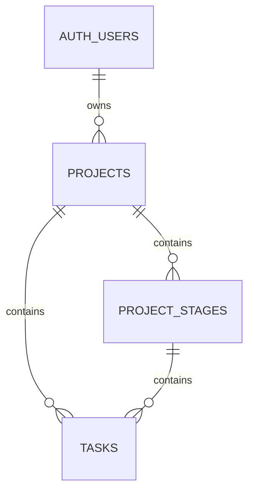

# Task Board database

Applied to the connected **Taskboard** Supabase project, reference `jnehjelpwqqqeldsbeag`.

## Simplified schema

| Table | Columns |
| --- | --- |
| `auth.users` | Supabase-managed user accounts; no separate public users table |
| `public.projects` | `id`, `title`, `description`, `owner_id` → `auth.users.id` |
| `public.project_stages` | `id`, `project_id`, `name`, `position` |
| `public.tasks` | `id`, `project_id`, `stage_id`, `title`, `description`, `position`, `done` |



There is **no project members table**. Users only access their own projects and their projects' stages and tasks. `owner_id` defaults to the authenticated Supabase user ID. Task/project/stage IDs are UUIDs. Task completion is an explicit boolean, independent of customizable stage names.

A composite foreign key ensures a task's stage belongs to the same project. Positions are nonnegative and intentionally not unique, allowing tasks or stages to be reordered without temporary uniqueness violations. Use `order by position, id` for deterministic ordering. Deleting a project removes its stages and tasks; deleting a stage removes its tasks. Deleting an Auth user removes their projects.

Create the initial stages (`Not Started`, `In Progress`, `Done`, positions 0–2) when the application creates a project. The migration defines the schema without inserting application data.

## Access control

All three public tables have RLS enabled and four explicit policies: SELECT, INSERT, UPDATE, DELETE. Project policies require `owner_id = (select auth.uid())`. Stage and task policies require ownership of the parent project. UPDATE policies check both existing and proposed rows, preventing cross-user ownership and project reassignment.

Only `authenticated` receives SELECT/INSERT/UPDATE/DELETE privileges. Anonymous clients have no table access. Neither anonymous nor authenticated clients receive TRUNCATE privileges. As with all Supabase projects, administrative/service roles bypass RLS and must stay server-side.

## Applied migrations and local export

- `20261025075504_initial_taskboard_schema.sql`: schema, constraints, indexes, grants, and 12 RLS policies.
- `20261025080546_restrict_auto_rls_trigger_execution.sql`: removes direct API execution privileges from the project's existing `public.rls_auto_enable()` internal event-trigger function, preserving automatic RLS behavior. This migration assumes that Supabase-provisioned function exists, as it does on the connected project.

The remote migration history and SQL statements were retrieved from `supabase_migrations.schema_migrations`. `remote-migration-history.json` records the actual remote versions and statements. Local SQL matches that history. To regenerate the SQL files from the retrieved snapshot:

```sh
node scripts/export-supabase-migrations.mjs
```

The CLI fetch requires a separate CLI login; the connected MCP session was used for this export. To refresh through the CLI after login:

```sh
npm exec --yes --package supabase -- supabase migration fetch --project-ref jnehjelpwqqqeldsbeag
```

Do not apply the exported SQL again to the connected database: both migrations are already recorded there. Future schema changes belong in new migrations.

## Verification

`tests/owner_rls.sql` runs with an administrative connection in a transaction that rolls back all temporary users and records. It verifies owner CRUD, cross-user read/write denial, ownership reassignment denial, stage/project consistency, anonymous denial, and cascading deletion. The test passed on the connected project. Supabase's security advisor returned no findings after the migrations.

## Application integration boundary

This change provisions the Supabase schema and RLS. The deployed application still uses its existing D1 backend and ChatGPT sign-in. Switching the frontend/backend to Supabase Auth and these tables is a separate application change; no live application records were moved or deleted.
